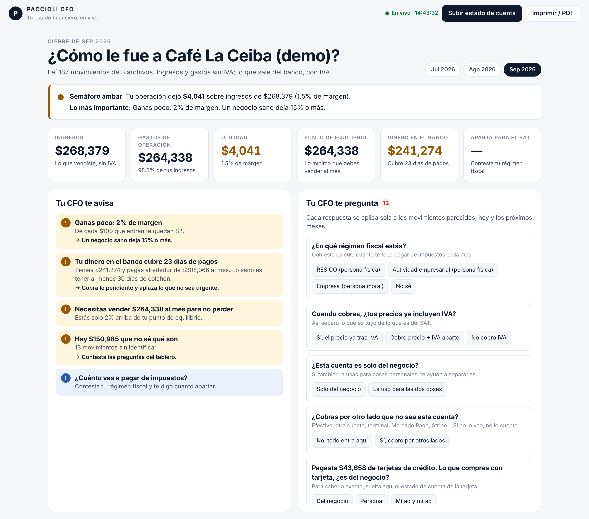
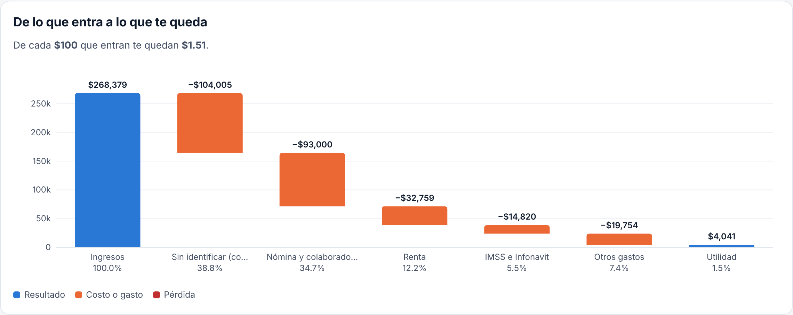
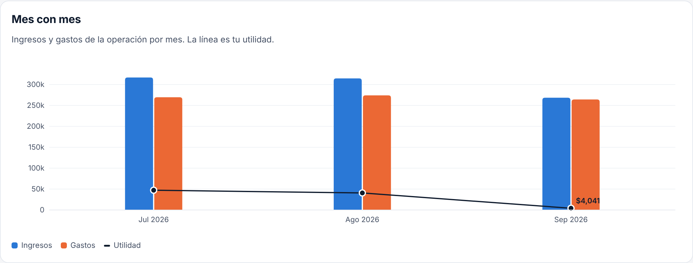

<div align="center">

# Paccioli CFO

### Un skill de CFO que crea tu dashboard.

Le das tu estado de cuenta, de cualquier banco. Te arma tu dashboard financiero:<br>
cuánto te entró, cuánto gastaste, cuánto te quedó, cuánto apartar para impuestos y qué arreglar. **Gratis.**

[](https://github.com/pachio2509/paccioli-cfo/actions/workflows/pruebas.yml)




</div>

---

## ¿Para quién es?

Para **cualquiera que cierra el mes sin saber cómo le fue**:

- **Dueños de negocio y emprendedores:** cuánto vendiste, tu utilidad real, tu punto de equilibrio y tus impuestos.
- **Independientes y profesionistas:** cuánto cobraste, cuánto te quedó y cuánto apartar.
- **Finanzas personales:** cuánto te entró, en qué se te fue y cuánto ahorraste.

En **cualquier país**: México (con ISR, RESICO e IVA), Colombia, Perú, Chile, Argentina, España y más, con tu moneda y tu impuesto (IVA, IGV, ITBIS…).

No necesitas saber contabilidad. Si sabes descargar tu estado de cuenta, ya puedes.

## Úsalo como te sea más fácil

### Opción 1 · El skill de CFO en Claude (lo más fácil)

1. Descarga el skill: **[paccioli-cfo-skill.zip](https://github.com/pachio2509/paccioli-cfo/releases/latest/download/paccioli-cfo-skill.zip)**.
2. Súbelo a Claude: **Configuración → Capacidades → Skills → Subir skill**.
   ¿Usas Claude Code? Descomprímelo en `~/.claude/skills/`.
3. Escríbele a Claude: *"Aquí está mi estado de cuenta, hazme mi dashboard"* y adjunta tu archivo.

Claude lo lee (de **cualquier banco**, aunque sea un PDF escaneado o una foto), lo cuadra contra tu banco, te hace 2 o 3 preguntas y te entrega tu dashboard.

### Opción 2 · En tu computadora, en un paso

**Mac:** abre la app **Terminal**, pega esto y presiona Enter:

```bash
curl -fsSL https://raw.githubusercontent.com/pachio2509/paccioli-cfo/main/instalar-en-1-paso.sh | bash
```

Se instala, te deja un acceso **«Paccioli CFO»** en tu Escritorio y abre tu tablero. Las siguientes veces, doble clic en ese acceso.

**Windows:** descarga el [ZIP](https://github.com/pachio2509/paccioli-cfo/archive/refs/heads/main.zip), descomprímelo y haz doble clic en `iniciar.bat`.
(Necesitas [Python 3.9 o más nuevo](https://www.python.org/downloads/); al instalarlo marca *Add Python to PATH*.)

### Opción 3 · Para quien usa git

```bash
git clone https://github.com/pachio2509/paccioli-cfo.git && cd paccioli-cfo && ./iniciar.sh
```

> ¿Quieres verlo antes de usar tus datos? Corre `./iniciar.sh --demo` (o `iniciar.bat --demo`) y juega con **Café La Ceiba**, un negocio de ejemplo.

### Después: suelta tu estado de cuenta

Se abre tu navegador con **Lucca**, tu CFO. **Arrastra tu estado de cuenta** (PDF, Excel o CSV de tu banco) y en un minuto ves cuánto te entró, cuánto gastaste, cuánto te quedó y cuánto apartar para impuestos.

## Qué te dice

| | |
|---|---|
| **Semáforo** | En una frase: cómo te fue y qué es lo más importante. |
| **Ingresos, gastos y utilidad** | Sin IVA (o IGV, ITBIS…), como los ve un CFO. Lo que es de tu autoridad fiscal no es tuyo. |
| **Punto de equilibrio** | Lo mínimo que tienes que vender al mes para no perder. |
| **Colchón de caja** | Cuántos días de pagos cubre lo que tienes en el banco. |
| **Aparta para impuestos** | En México: ISR + IVA según tu régimen (RESICO, actividad empresarial o persona moral) y cuándo vence. En otros países: el IVA/IGV por pagar. |
| **¿Quién te paga?** | Tus clientes y canales. Te avisa si dependes demasiado de uno. |
| **¿En qué se va tu dinero?** | Todo lo que salió, por concepto. |
| **Estado de resultados** | Completo, con lo que va "debajo de la línea" (tarjetas, créditos, retiros). |



## Te pregunta lo que no entiende

Un banco dice `SPEI RECIBIDO EVENTOS PENINSULA SA DE CV`. ¿Es una venta? ¿Un préstamo? ¿Dinero tuyo de otra cuenta?
Paccioli **no adivina en silencio**: te pregunta.

- ¿En qué régimen fiscal estás?
- ¿Tus precios ya incluyen IVA?
- ¿Cobras por otro lado que no sea esta cuenta? ¿Cuánto al mes?
- Pagaste $43,658 de tarjetas. ¿Lo que compras con tarjeta es del negocio?
- Pagaste $203,349 a «Granos del Soconusco». ¿Qué es?

Contestas con un clic **y se aplica sola** a los movimientos parecidos, hoy y los próximos meses. Lo que todavía no sabe qué es, lo cuenta como gasto (mejor sorprenderte para bien).

## Y te avisa

- 🔴 **Este mes perdiste $2,402.** Revisa tus 3 gastos más grandes.
- 🟠 **Tu dinero en el banco cubre 23 días de pagos.** Lo sano es tener 30 o más.
- 🟠 **62% de tus ventas viene de un solo cliente.** Si se va, tu negocio se cae.
- 🟠 **No veo pago al SAT este mes.** Tu declaración vence el 19 de octubre.
- 🟠 **Vas a $3.6 millones al año: cerca del tope de RESICO.**
- 🟠 **Sacaste $30,000 para gastos personales.** Ponte un sueldo fijo.



## En vivo

Deja abierto el tablero. Cada vez que sueltas un archivo nuevo en la carpeta `mis-estados-de-cuenta/` (o lo arrastras al navegador) **se recalcula solo**. Sin botones, sin "actualizar".

## Tus datos no salen de tu computadora

- Todo corre en tu compu (`127.0.0.1`). No hay nube, no hay cuenta, no hay login.
- Tus estados de cuenta y respuestas viven en `mis-estados-de-cuenta/` y `mi-negocio/`, que **nunca se suben a GitHub** (están en `.gitignore`).
- El código es abierto: puedes revisar línea por línea qué hace.

## Bancos que lee

| Archivo | Estado |
|---|---|
| **PDF de cualquier banco** (BBVA, Santander, Banorte, Banamex, HSBC, Scotiabank, Nu, Hey, Mercado Pago...) | ✅ Lee las columnas solo y **revisa que cada saldo cuadre al centavo**. Si no cuadra, te lo dice en rojo. |
| **Excel / CSV** de cualquier banco o app | ✅ Si trae saldo, revisa que cada renglón cuadre |
| **PDF escaneado o foto** | ✅ Con el skill de Claude (opción 1): Claude lo transcribe y el programa lo valida contra los saldos |

¿Tu banco no cuadra? [Abre un issue](https://github.com/pachio2509/paccioli-cfo/issues) con el nombre del banco (**nunca subas tu estado de cuenta real**).

## Cómo piensa (los principios de un CFO)

1. **El banco es la verdad.** Si no cuadra con el banco, no se reporta.
2. **Resultados sin IVA, flujo con IVA.** El IVA cobrado no es tuyo.
3. **El fondo sobre la forma.** Pagar la tarjeta no es un gasto; lo que compraste con ella, sí.
4. **Un mes incompleto se marca como incompleto.** Nada de números a medias disfrazados.
5. **Cada criterio que decides se vuelve regla.** Contestas una vez.

Más detalle en [docs/como-funciona.md](docs/como-funciona.md).

## Úsalo con tu marca (contadores, despachos y consultores)

¿Quieres dárselo a tus clientes con tu nombre? Copia `marca.ejemplo.json` como `marca.json` junto al programa y pon tu nombre, tu WhatsApp, tu correo, tu logo y tus colores. El dashboard, el archivo exportado y el skill (`./skill/empaquetar.sh`) salen con tu marca. Con `"mostrar_asesor": false` no aparece ningún contacto.

## ¿Necesitas algo más especializado?

Planeación fiscal, contabilidad, declaraciones o un CFO que revise tus números contigo: escríbele a **Jorge Ayala** (Kaptal) por [WhatsApp 999 175 0122](https://wa.me/529991750122) o a [jorge@kaptal.com.mx](mailto:jorge@kaptal.com.mx).

## Para desarrolladores

```bash
python -m paccioli_cfo                  # tablero (carpeta actual)
python -m paccioli_cfo --demo           # negocio de ejemplo
python -m paccioli_cfo resumen          # tus números en la terminal
python -m paccioli_cfo exportar         # tu tablero en un solo archivo HTML (sin servidor)
python -m paccioli_cfo preguntas        # lo que el CFO necesita saber (JSON)
python -m paccioli_cfo responder ID VALOR
./skill/empaquetar.sh                   # arma dist/paccioli-cfo-skill.zip
python -m paccioli_cfo --carpeta ~/mi-negocio --puerto 9000
python -m pytest                        # pruebas (solo datos inventados)
```

Sin frameworks: Python estándar + `pdfplumber` + `openpyxl`. El tablero es HTML/JS/SVG puro. Ver [CONTRIBUTING.md](CONTRIBUTING.md).

---

<div align="center">

**Paccioli CFO** es un proyecto de [Kaptal](https://kaptal.com.mx) · Mérida, México.<br>
¿Quieres que un CFO de verdad revise tus números? Escríbenos.

<sub>Los cálculos de impuestos son estimaciones informativas con la tarifa 2026 y no sustituyen a tu contador.</sub>

</div>
